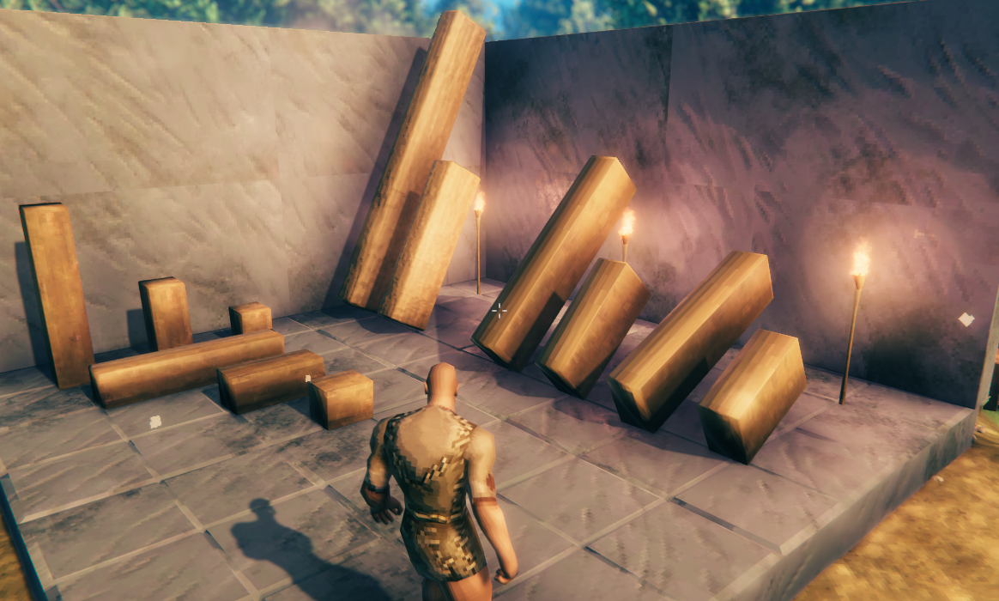

# HalfBeam

Half-sized beams so you can build with more precision.
This mod adds shorter variants of the wood, ashwood, darkwood, wood iron, timber, decorated timber, log, flametal, dvergr and grausten beams and poles, 59 new pieces in total.

## Pieces

| Wood type        | Beams and poles                                  | Diagonal beams   |
| ---------------- | ------------------------------------------------ | ---------------- |
| Wood             | 0.5m (half)                                      | 26°, 45° and 67° |
| Log (core wood)  | 1m (half) and 0.5m (quarter)                     | 26°, 45° and 67° |
| Worn log         | Poles: 2m (half), 1m (quarter) and 0.5m (eighth) | -                |
| Wood iron        | 1m (half) and 0.5m (quarter)                     | 26°, 45° and 67° |
| Darkwood         | 1m (half) and 0.5m (quarter)                     | 26°, 45° and 67° |
| Dvergr           | Poles: 2m (full), 1m (half) and 0.5m (quarter)   | -                |
| Ashwood          | 0.5m (half)                                      | 26°, 45° and 67° |
| Grausten         | Small and medium beams and pillars: 0.5m (half)  | -                |
| Flametal         | Beams and pillars: 1m (half) and 0.5m (quarter)  | -                |
| Timber           | 1m (half) and 0.5m (quarter)                     | 26°, 45° and 67° |
| Decorated timber | 1m (half) and 0.5m (quarter)                     | 26°, 45° and 67° |

Full, half, quarter and eighth are the fraction of the vanilla length, which is also how the icons are named.
Diagonals are half the vanilla length, so they span 1m across and 0.5m, 1m or 2m up.
Each piece costs half its original materials, rounded up to a minimum of 1.
The new pieces are listed in the same order as their vanilla originals, so they're easy to find in the Architecture tab.
Vanilla can't build the dvergr pole, so this mod also adds a full-length 2m one.
Log beams keep all four snap points, along the top and bottom at each end.

Darkwood, wood iron and decorated timber pieces are shortened by cutting a section out of the middle, so their trims, iron bands and patterns keep their real size. The other pieces are scaled.
The 0.5m decorated timber pieces and the decorated timber 26° beam are squashed slightly so they show whole rings.
Shorter dvergr poles keep their copper band at its real size, and only the wood is scaled.

## Configuration

This mod has no settings.

## Compatibility

- Other mods that add beams and poles should work alongside this one, as these are separate pieces.
- This mod has not been tested with a gamepad, only with keyboard and mouse.

## Uninstalling

Half and quarter beams and poles disappear from the world when the mod is removed, so anything resting on them may collapse.
Replace them with vanilla pieces first if you want to keep a build standing.

## License

This project is licensed under the MIT License - see the [LICENSE](https://github.com/javidahmed64592/Valheim-HalfBeam/blob/main/LICENSE) file for details.
