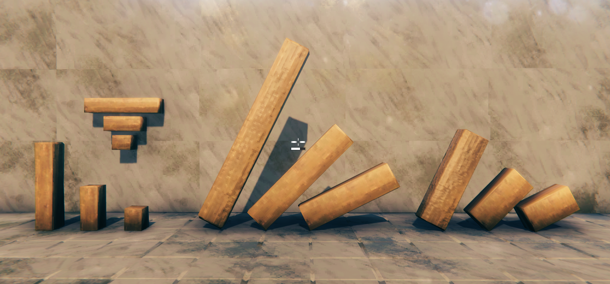
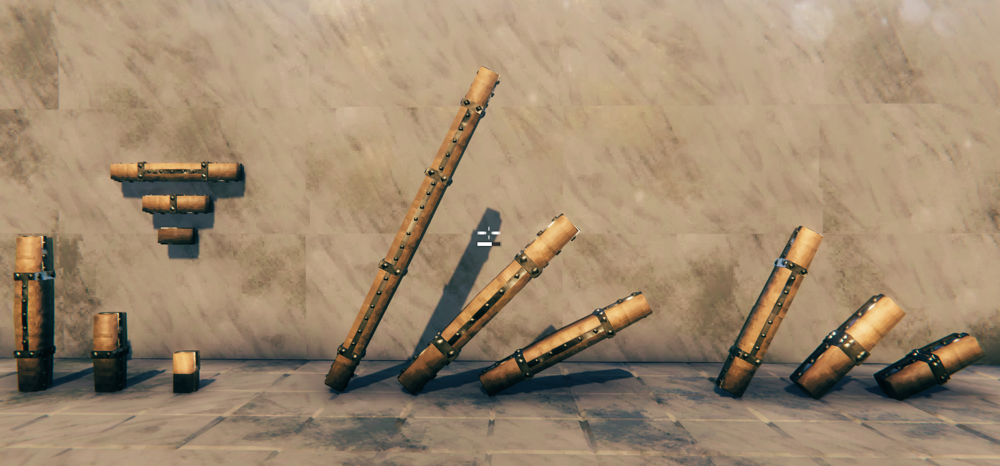
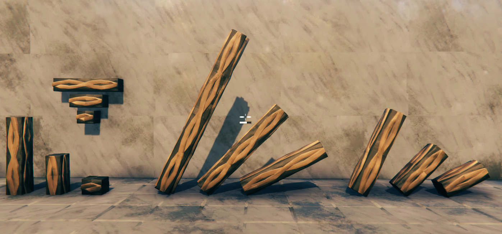
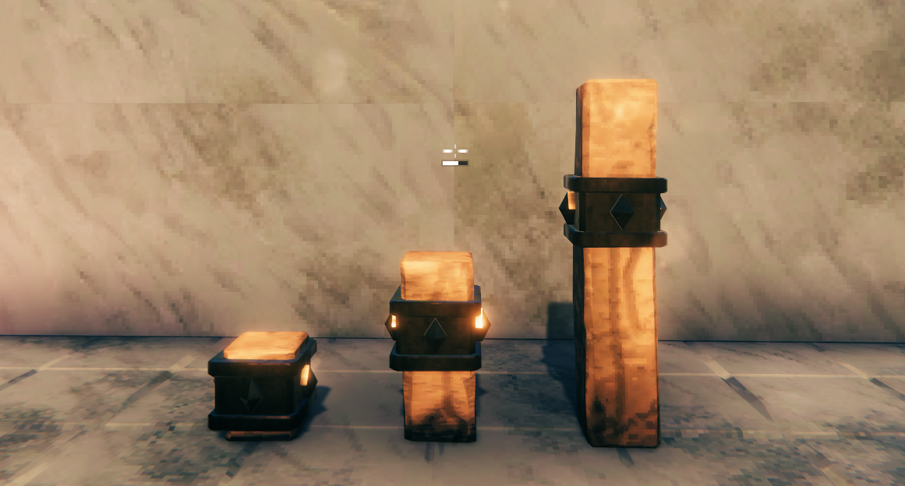
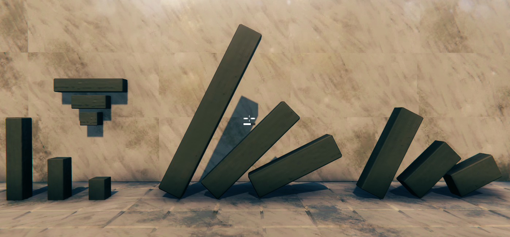
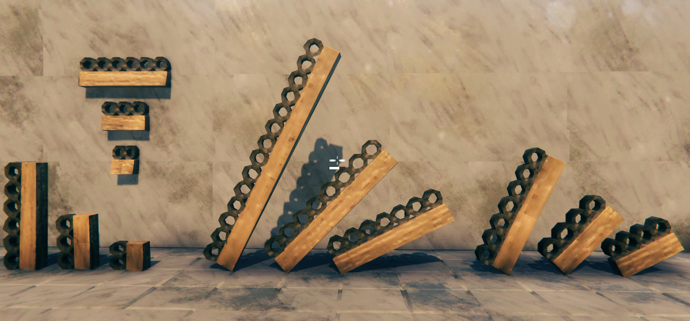
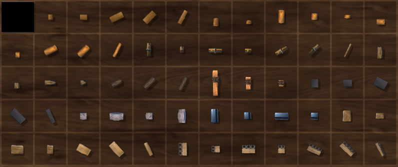

# HalfBeam

Half-sized beams so you can build with more precision.
This mod adds shorter variants of the wood, ashwood, darkwood, wood iron, timber, decorated timber, log, flametal, dvergr and grausten beams and poles, 59 new pieces in total.

## Pieces

| Wood type        | Beams and poles                                  | Diagonal beams   |
| ---------------- | ------------------------------------------------ | ---------------- |
| Wood             | 0.5m (half)                                      | 26°, 45° and 67° |
| Log (core wood)  | 1m (half) and 0.5m (quarter)                     | 26°, 45° and 67° |
| Worn log         | Poles: 2m (half), 1m (quarter) and 0.5m (eighth) | -                |
| Wood iron        | 1m (half) and 0.5m (quarter)                     | 26°, 45° and 67° |
| Darkwood         | 1m (half) and 0.5m (quarter)                     | 26°, 45° and 67° |
| Dvergr           | Poles: 2m (full), 1m (half) and 0.5m (quarter)   | -                |
| Ashwood          | 0.5m (half)                                      | 26°, 45° and 67° |
| Grausten         | Small and medium beams and pillars: 0.5m (half)  | -                |
| Flametal         | Beams and pillars: 1m (half) and 0.5m (quarter)  | -                |
| Timber           | 1m (half) and 0.5m (quarter)                     | 26°, 45° and 67° |
| Decorated timber | 1m (half) and 0.5m (quarter)                     | 26°, 45° and 67° |

## Configuration

This mod has no settings.

## Compatibility

- Other mods that add beams and poles should work alongside this one, as these are separate pieces.
- This mod has not been tested with a gamepad, only with keyboard and mouse.

## Uninstalling

Half and quarter beams and poles disappear from the world when the mod is removed, so anything resting on them may collapse.
Replace them with vanilla pieces first if you want to keep a build standing.

## License

This project is licensed under the MIT License - see the [LICENSE](https://github.com/javidahmed64592/Valheim-HalfBeam/blob/main/LICENSE) file for details.
